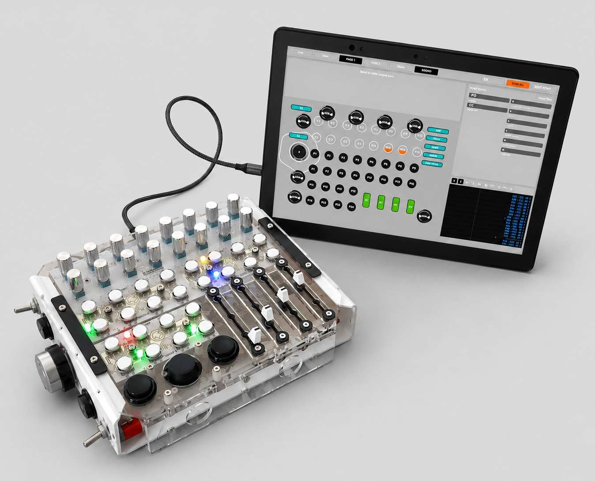
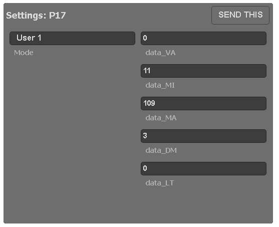

# DART Sketch



DART Sketch is MIDI controller firmware for Arduino. The **STANDARD** profile is selected when you download the sketch. It lets you start with a button and a fader wired directly to an Arduino Leonardo, then configure them from DART_EDIT.

## First use with a Leonardo

1. Extract the project ZIP, then open `DART_SKETCH/DART_SKETCH.ino` in Arduino IDE. Select **Arduino Leonardo** and its port, then upload the sketch.
2. In the **Hello World** wiring diagram, the button goes to **A0** and the fader to **A3**. Wire each LED with a resistor in series. On a board without a stored preset, STANDARD uses Autodetect. [Hello World tutorial](https://dartmobo.com/diy-tips-1/#hello)
3. Open **Arduino-only** in DART_EDIT. In **PORTS**, select the controller under MIDI IN and MIDI OUT. **SEND ALL** writes the preset to the controller. You can then see the A0 button send note 64 and the A3 fader send CC 24 on MIDI channel 1. [Open Arduino-only](https://dartmobo.com/editor_redirect/?preset=arduino-only.csv)
4. To return to Autodetect, choose **LOAD → Blank**, then **SEND ALL**. Uploading the sketch again leaves the stored preset in EEPROM. [Reset instructions](https://dartmobo.com/diy-tips-1/#clear)

## Board setup

For the Leonardo, select the Arduino AVR Boards core. If the IDE reports a missing `Mouse.h` or `Keyboard.h`, install the Arduino **Mouse** and **Keyboard** libraries through Library Manager. The Uno R3 uses serial MIDI and requires a separate USB-MIDI setup. For an Adafruit Metro M0 Express, install the Adafruit SAMD board support and the Adafruit TinyUSB library, then select **Tools → USB Stack → TinyUSB**.

## Controller profiles

A firmware profile sets up the hardware when the sketch is compiled. Set `DART_PROFILE` in `DART_SKETCH/DART_config.h` to one of the following values.

| Controller | Firmware profile | Preset in DART_EDIT |
| --- | --- | --- |
| First DIY controller wired directly to a Leonardo | **1 — STANDARD** (default) | **Arduino-only** for Hello World |
| Custom DIY build | **2 — CUSTOM** (starts with STANDARD settings) | Your choice |
| KOROVA | **3 — KOROVA/ONE** | **Korova** |
| ONE | **3 — KOROVA/ONE** | **ONE** |

To personalise a DIY build, select **2 — CUSTOM**. It inherits STANDARD until you override a setting in the CUSTOM section of `DART_config.h`. For a controller that sends no computer keystrokes, disable keyboard output inside that section.

```cpp
#undef hid_keys
#define hid_keys 0
```

KOROVA and ONE use the same firmware profile. Choose the matching controller preset under **LOAD** in DART_EDIT and send it to the controller. [DART_EDIT overview](https://dartmobo.com/dart_diy/dart_editor/)

## Custom controls

In the Settings box, **USER1–USER4** assign custom code to a control. The corresponding functions run as the sketch scans the input. The five parameters from the editor are `data_VA`, `data_MI`, `data_MA`, `data_DM` and `data_LT`. Look in `DART_SKETCH/D_MOD.ino` for the user functions and `DART_SKETCH/D_Guides.ino` for the firmware guide.



For builds based on a DARTmobo, the `AIN()` input routine scans the multiplexed inputs on the board. [DARTmobo DIY](https://dartmobo.com/dartmobo/dartmobo-diy/)


## License

DART Sketch is released under GPL-3.0-or-later. [License](DART_SKETCH/LICENSE) · [Third-party notices](DART_SKETCH/THIRD_PARTY_NOTICES.md)
